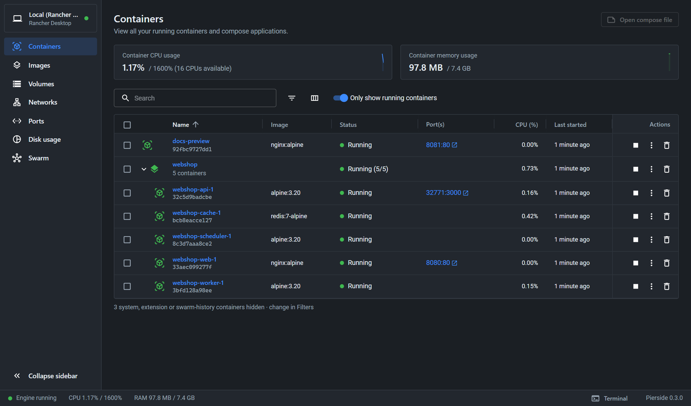
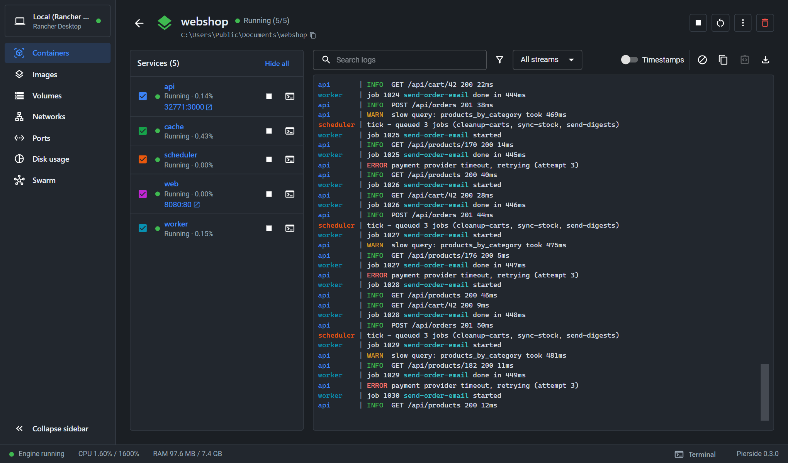
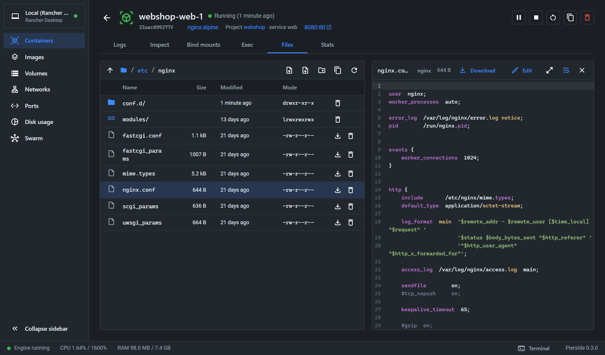

# Pierside

A Docker Desktop–style container UI for [Rancher Desktop](https://rancherdesktop.io/). It installs as a Rancher Desktop extension and adds a **Pierside** tab where you manage containers, images, volumes and more, on your own machine or on remote servers over SSH.

Pierside is an independent open-source project. It is not affiliated with Docker, Inc. or SUSE.



| Merged Compose logs | Files and code editor |
|---|---|
|  |  |

## Requirements

- Rancher Desktop 1.23 or newer (Windows, macOS or Linux; amd64 or arm64)
- Container engine set to **dockerd (moby)** in Rancher Desktop's preferences. containerd/nerdctl is not supported.

## Install

```sh
rdctl extension install ghcr.io/hemi131/pierside:latest
```

Then open **Pierside** in Rancher Desktop's sidebar. To pin a version, use its number instead of `latest`, for example `ghcr.io/hemi131/pierside:0.1.0`. All versions are listed under [Releases](https://github.com/Hemi131/Pierside/releases); the image itself is on the [package page](https://github.com/Hemi131/Pierside/pkgs/container/pierside).

## Update

Pierside shows **Update available** in its footer when a newer release exists, with the exact commands for your installation. By hand:

```sh
docker pull ghcr.io/hemi131/pierside:latest
rdctl extension uninstall ghcr.io/hemi131/pierside:latest
rdctl extension install ghcr.io/hemi131/pierside:latest
```

The `docker pull` matters: Rancher Desktop installs from the image already on your machine and does not download a newer `latest` by itself. Your engines, SSH keys and settings are kept. Details in [Install and update](docs/install-and-update.md).

## What it does

- **Containers:** live list grouped by Compose project, start/stop/restart/delete (single, project or bulk), port links, CPU usage, port-conflict hints, health checks and alerts for crashing or out-of-memory containers.
- **Container details:** live logs with search, timestamps and download; inspect; bind mounts; an interactive shell; a debug shell for containers that have none; a file browser; live stats.
- **Compose:** merged, colour-coded logs of all services; Up, Down, Pull and recreate, and View configuration with the common flags. Projects stay listed after `down`.
- **Files:** browse, upload, edit (code editor with syntax highlighting), delete and change permissions, in containers and in volumes.
- **Images:** pull with progress, run with options, inspect layers, prune, copy an image to another engine without a registry.
- **Volumes and networks:** create, inspect, prune; connect and disconnect containers.
- **Ports:** forward a container port to `localhost` without recreating the container, including from a remote server.
- **Disk usage:** what takes space, with one-click cleanup.
- **Remote engines:** manage Docker on other machines over SSH; give each a colour so production is hard to miss.
- **Swarm:** stacks, services, tasks, nodes, secrets and configs.
- **Terminal:** a Docker console for the local engine, a full shell on SSH engines.

## Documentation

- [Install and update](docs/install-and-update.md)
- [Remote engines over SSH](docs/remote-engines.md)
- [Compose projects](docs/compose.md)
- [Ports and forwarding](docs/ports.md)
- [Files, volumes and the editor](docs/files-and-volumes.md)
- [Troubleshooting](docs/troubleshooting.md)
- [Building from source](docs/building.md)
- [Changelog](CHANGELOG.md)

## Privacy

Pierside runs entirely on your machine. The only request it makes on its own is a once-a-day check of this repository's newest release number on GitHub, which sends nothing about your installation and can be switched off (click the version in the footer).

## About this repository

Development happens in a private repository; this one receives the complete source of each release as a single commit. Bug reports and suggestions are welcome as [issues](https://github.com/Hemi131/Pierside/issues).

## License

Apache License 2.0; see [LICENSE](LICENSE) and [NOTICE](NOTICE). Third-party components are listed in [THIRD_PARTY_NOTICES.md](THIRD_PARTY_NOTICES.md).

"Docker", "Docker Desktop", "Rancher" and "Rancher Desktop" are trademarks of their respective owners and are used only to describe compatibility.
